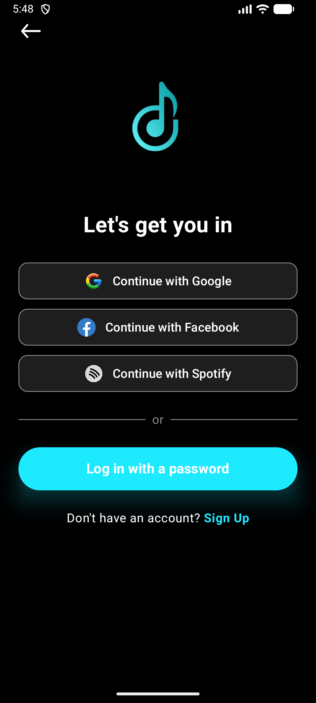

<div align="center">

# 🎵 MyMuzic
<p align="center"></p>

<h4 align="center">A Spotify-powered music discovery app for Android</h4>

[](https://android.com)
[](https://kotlinlang.org)
[](https://developer.android.com/jetpack/compose)
[](https://developer.spotify.com)
[](https://android.com)

[English](#english) • [Tiếng Việt](#tiếng-việt) • [日本語](#日本語)


</div>

---

## Screenshots

[](assets/screenshots/home_screen.png)
[](assets/screenshots/home_screen.png)
## English

### About

MyMuzic is an Android music discovery app that integrates with the Spotify Web API. Browse your recently played tracks, explore new releases, discover artists, and search across the entire Spotify catalog — all in a clean dark-themed UI.

### Features

- **Home** — Recently played tracks, top mixes, recommended artists
- **Explore** — New releases, music categories, featured playlists (Viral Hits, Today's Top Hits, Global Top 50)
- **Search** — Global search across songs, artists, albums, and playlists
- **Library** — Your saved content
- **Artist Detail** — Full artist profile, albums, top tracks, related artists
- **Album Detail** — Album tracks and metadata
- **Playlist Detail** — Browse and play playlist tracks
- **Now Playing** — Track player with Spotify App Remote integration
- **Spotify OAuth** — Secure login with PKCE flow

### Tech Stack

| Category | Technology |
|---|---|
| Language | Kotlin |
| UI | Jetpack Compose + Material 3 |
| Architecture | Clean Architecture + MVVM |
| DI | Koin |
| Networking | Retrofit + OkHttp + Ktor |
| Auth | Spotify OAuth 2.0 (PKCE) |
| Playback | Spotify App Remote SDK |
| Image Loading | Coil |
| Async | Kotlin Coroutines + StateFlow |
| Storage | Security Crypto (encrypted SharedPreferences) |

### Architecture

```
presentation/       → Compose UI + ViewModels + Navigation
domain/             → Use Cases + Repository Interfaces
data/               → API clients + Repository Implementations + Local Storage
di/                 → Koin modules
```

### Getting Started

1. Clone the repo
2. Create a Spotify Developer app at [developer.spotify.com](https://developer.spotify.com)
3. Add your `Client ID` to `RepositoryModule.kt`
4. Add redirect URI `com.example.mymuzic://callback` in your Spotify app settings
5. Build and run on Android 9+ (API 28+)

> **Note:** Spotify playback requires the Spotify app to be installed on the device.

---

## Tiếng Việt

### Giới thiệu

MyMuzic là ứng dụng Android khám phá âm nhạc tích hợp với Spotify Web API. Xem lại các bài hát đã nghe gần đây, khám phá nhạc mới, tìm kiếm nghệ sĩ và duyệt toàn bộ danh mục Spotify — tất cả trong giao diện tối hiện đại.

### Tính năng

- **Trang chủ** — Bài hát đã nghe gần đây, top mix, nghệ sĩ gợi ý
- **Khám phá** — Nhạc mới phát hành, danh mục âm nhạc, playlist nổi bật
- **Tìm kiếm** — Tìm kiếm toàn cục theo bài hát, nghệ sĩ, album, playlist
- **Thư viện** — Nội dung đã lưu của bạn
- **Chi tiết nghệ sĩ** — Hồ sơ đầy đủ, album, top tracks, nghệ sĩ liên quan
- **Chi tiết album** — Danh sách bài hát và thông tin album
- **Chi tiết playlist** — Duyệt và phát playlist
- **Đang phát** — Giao diện player tích hợp Spotify App Remote
- **Đăng nhập Spotify** — Xác thực an toàn với PKCE flow

### Công nghệ sử dụng

| Nhóm | Công nghệ |
|---|---|
| Ngôn ngữ | Kotlin |
| UI | Jetpack Compose + Material 3 |
| Kiến trúc | Clean Architecture + MVVM |
| DI | Koin |
| Mạng | Retrofit + OkHttp + Ktor |
| Xác thực | Spotify OAuth 2.0 (PKCE) |
| Phát nhạc | Spotify App Remote SDK |
| Tải ảnh | Coil |
| Bất đồng bộ | Kotlin Coroutines + StateFlow |
| Lưu trữ | Security Crypto (SharedPreferences mã hóa) |

### Kiến trúc

```
presentation/       → Compose UI + ViewModel + Navigation
domain/             → Use Case + Repository Interface
data/               → API client + Repository Implementation + Local Storage
di/                 → Koin modules
```

### Cài đặt & Chạy

1. Clone repo về máy
2. Tạo Spotify Developer app tại [developer.spotify.com](https://developer.spotify.com)
3. Thêm `Client ID` vào `RepositoryModule.kt`
4. Thêm redirect URI `com.example.mymuzic://callback` trong cài đặt Spotify app
5. Build và chạy trên Android 9+ (API 28+)

> **Lưu ý:** Tính năng phát nhạc yêu cầu cài đặt ứng dụng Spotify trên thiết bị.

---

## 日本語

### アプリについて

MyMuzicは、Spotify Web APIと連携したAndroid音楽発見アプリです。最近再生したトラックの確認、新リリースの探索、アーティストの発見、Spotifyカタログ全体の検索など、すべてをクリーンなダークテーマのUIで提供します。

### 機能

- **ホーム** — 最近再生したトラック、トップミックス、おすすめアーティスト
- **探索** — 新リリース、音楽カテゴリ、注目プレイリスト
- **検索** — 曲、アーティスト、アルバム、プレイリストのグローバル検索
- **ライブラリ** — 保存したコンテンツ
- **アーティスト詳細** — プロフィール、アルバム、人気曲、関連アーティスト
- **アルバム詳細** — トラックリストとメタデータ
- **プレイリスト詳細** — プレイリストの閲覧と再生
- **再生中** — Spotify App Remote統合プレーヤー
- **Spotifyログイン** — PKCEフローによる安全な認証

### 技術スタック

| カテゴリ | 技術 |
|---|---|
| 言語 | Kotlin |
| UI | Jetpack Compose + Material 3 |
| アーキテクチャ | Clean Architecture + MVVM |
| DI | Koin |
| ネットワーク | Retrofit + OkHttp + Ktor |
| 認証 | Spotify OAuth 2.0 (PKCE) |
| 再生 | Spotify App Remote SDK |
| 画像読み込み | Coil |
| 非同期 | Kotlin Coroutines + StateFlow |
| ストレージ | Security Crypto (暗号化SharedPreferences) |

### セットアップ

1. リポジトリをクローン
2. [developer.spotify.com](https://developer.spotify.com) でSpotify Developerアプリを作成
3. `RepositoryModule.kt` に `Client ID` を追加
4. Spotifyアプリ設定にリダイレクトURI `com.example.mymuzic://callback` を追加
5. Android 9以上 (API 28+) でビルド・実行

> **注意:** 音楽再生機能にはデバイスにSpotifyアプリのインストールが必要です。

---

<div align="center">

Made with ❤️ using Kotlin & Jetpack Compose

</div>
